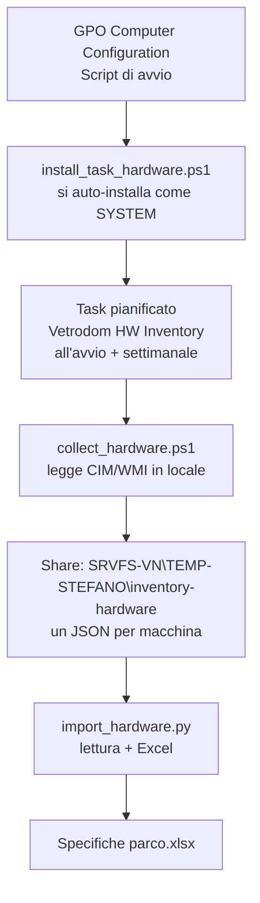

# Specifiche tecniche del parco PC — metodo di rilevazione e template

> Documento interno ZBN / Vetronaviglio. Redatto il 2026-09-28 su richiesta di Agis Lab:
> «descrivere i PC fissi e mobili nelle specifiche tecniche: RAM, processore, ecc. ecc.»
> **Non è un documento fiscale.** Nessun dato qui contenuto è stato ancora raccolto:
> questo documento descrive **come** raccoglierlo, non **cosa** è stato trovato.

---

## 1. Punto di partenza onesto: cosa c'è e cosa non c'è

| Fonte | Cosa raccoglie | **RAM / CPU?** |
|---|---|---|
| `app/lan_inventory/` (NMAP) | IP, MAC, hostname, vendor (OUI), porte aperte, ruolo dedotto | **NO** |
| `app/lan_inventory/windows_inventory.py` (WinRM/CIM) | modello, seriale, BIOS, **CPU, core/thread, RAM**, dischi, NIC, OS, build, data installazione, ultimo boot | **SÌ** |
| Ricognizione manuale / fornitore | modello e anno dalla fattura | parziale |

**Il punto critico:** lo strumento che sa già leggere RAM e processore
(`windows_inventory.py`) è progettato per **server** e funziona **solo con WinRM
attivo + credenziali**. Sui 100+ host del LAN Inventory non è mai stato eseguito, e su
un parco client non lo si esegue in massa.

Quindi: **le specifiche tecniche del parco client oggi non esistono.** Vanno raccolte, e
la raccolta è la parte che va progettata con Agis Lab.

---

## 2. Tre livelli di raccolta (dal più invasivo e affidabile al più leggero)

### Livello 1 — Raccolta in loco con l'utente (realistico subito, bassa invasività)
Un operatore ZBN, in sede, apre un prompt **PowerShell come amministratore** su ogni
postazione e lancia uno script già pronto. Nessuna installazione, nessuna modifica
permanente, esecuzione in 5 secondi per macchina.

**Script (una riga, nessuna dipendenza, nessun upload di file):**

```powershell
Get-CimInstance Win32_ComputerSystem,Win32_Processor,Win32_PhysicalMemory,Win32_OperatingSystem,Win32_BIOS,Win32_ComputerSystemProduct |
  Select-Object Name,Manufacturer,Model,SerialNumber,NumberOfCores,NumberOfLogicalProcessors,
                @{n='RAM_GB';e={[math]::Round($_.TotalPhysicalMemory/1GB,1)}},Caption,Version,SMBIOSBIOSVersion |
  ConvertTo-Json
```

Da salire in Excel il risultato, o con la stessa potenza si può scrivere direttamente
in un CSV condiviso sulla rete (su share già mappati, es. `\\SRVFS-VN\TEMP-STEFANO`).

- **Pro:** nessuna infrastruttura, qualità dati alta (CPU e RAM esatti), eseguibile
  anche senza WinRM abilitato (funziona via PsExec/sessione interattiva).
- **Contro:** tempo-uomo proporzionale al numero di postazioni; serve un accordo con
  Agis Lab su **chi apre le macchine e in quali momenti**; richiede di essere
  fisicamente in sede.
- **Costo stimato:** ~5 minuti per macchina × parco client.

### Livello 2 — Distribuzione via Active Directory (scala, una volta sola)
Se Agis Lab ha un dominio AD con GPO (verificare), si può far scrivere in automatico
a ogni postazione un file di inventario su uno share, con un'attività pianificata
giornaliera. Il dominio diventa il "sensore": zero intervento per macchina.

- **Pro:** raccolta continua e automatica, tracciabilità nel tempo (si vedono i cambi
  hardware nel tempo), nessun presidio fisico.
- **Contro:** serve il consenso di chi amministra il dominio, richiede GPO configurata
  bene, il percorso dello share deve essere sicuro e i permessi corretti.

### Livello 3 — Agente di inventory (per chi vuole monitoring continuo)
Prodotti open-source in questo ecosistema: **GLPI Agent** (ex FusionInventory) o
**OCS Inventory**, entrambi gratuiti e adatti a un parco client. Raccolgono hardware,
software, rete, e sono già usati da molte realtà come questa.

- **Pro:** inventario vivo e completo, anche software e periferiche, utile per
  supporto e rinnovo hardware.
- **Contro:** introduce un agente installato su ogni macchina (va detto ad Agis Lab,
  non è una decisione da prendere in autonomia).

> **Raccomandazione (aggiornata 28/09):** chi amministra il dominio **non deve passare
> da PC a PC**. Il metodo corretto qui è il **Livello 1-bisautomatico** (§ 2-bis):
> GPO → task pianificato all'avvio → file JSON sulla share → importazione in Excel.
> Il Livello 1 manuale resta come piano B (parco piccolo, macchine non in dominio).
> Il Livello 3 si valuta solo con progetto dedicato e approvazione.

---

## 2-bis. Livello 1-bis — raccolta AUTOMATICA, senza passare da PC a PC

> **Perché questo livello esiste:** l'utente è lui stesso l'IT di ditta e amministra il
> dominio. Non serve alcuna visita in sede né alcun presidio per macchina: basta
> distribuire una policy e la raccolta parte da sola su tutto il parco.

**Vincolo verificato sui dati:** nelle scansioni LAN Inventory la **porta WinRM (5985)
risulta aperta su 0 host** dei 114 rilevati. Quindi l'approccio **pull** (WinRM, cioè
`windows_inventory.py` che va dal server verso i PC) **non funziona oggi** e
richiederebbe prima di aprire quella porta su tutto il parco. L'approccio **push**
(locale sul PC, senza porte aperte) è quindi il modo naturale.

### Come funziona



**I 3 file (già in `app/lan_inventory/`)**

| File | Ruolo | Quando gira |
|---|---|---|
| `collect_hardware.ps1` | raccoglie CPU, RAM (totale + **slot e moduli**, per capire se si può espandere), seriale, modello, BIOS, OS/build/data installazione, dischi, monitor, antivirus, IP/MAC, **tipo fisso/notebook** e **schede video** | sul PC, in locale, ~2-5 s |
| `install_task_hardware.ps1` | verifica che la share sia scrivibile, scrive un log locale in `C:\ProgramData\VetrodomInventory\install.log`, copia lo script in locale e crea il task pianificato "Vetrodom HW Inventory" (SYSTEM, `AtStartup` + settimanale con ritardo casuale, `-StartWhenAvailable`, 10 min di limite). `-Uninstall` per la rimozione completa | una volta per macchina, o via GPO |
| `import_hardware.py` | legge i JSON dalla share e genera l'Excel `Specifiche parco` (20 colonne) + foglio `Riepilogo` (openpyxl, fallback CSV) | dal PC dell'IT, quando si vuole il foglio |

### Cosa serve per attivarlo (3 passi, tutti dal server di dominio)

1. ~~**Preparare la share di destinazione**~~ su `\\SRVFS-VN\TEMP-STEFANO\inventory-hardware`
   — **fatto il 29/09/2026, con i permessi inclusi** (`/mnt/vetrodom-temporanea-stefano/inventory-hardware`
   è il suo mount Linux; percorso identico a quello previsto, nessuna modifica agli script).
   I permessi **non** sono su "Domain Computers" ma su un **gruppo AD dedicato**,
   `VETRODOM\SG-HardwareInventory-Writers`, con **due** permessi distinti:
   *Change* sulla condivisione `TEMP-STEFANO` e *Modify* sull'ACL NTFS della cartella
   `inventory-hardware`. È la scelta giusta perché è più stretta e reversibile
   (si revoca togliendo i PC dal gruppo, senza toccare la GPO).
2. **Distribuire via GPO** lo script di avvio Computer Configuration → Policies →
   Windows Settings → Scripts (Startup) che punta a `install_task_hardware.ps1`
   (oppure, senza GPO script: pubblicare `collect_hardware.ps1` in una GPO Preferences /
   la Startup folder via script di logon). Il task si installa da solo su ogni PC.
   **Parametro obbligatorio via GPO:** la Startup folder riceve il solo installer, non il
   collettore, quindi `-Script` va puntato al percorso UNC del collettore nella SYSVOL
   (campo "Script Parameters" della GPO), altrimenti `Copy-Item` fallisce:

   ```
   -Script \\dc01-vn.vetrodom.local\SYSVOL\Vetrodom.local\scripts\hardware-inventory\collect_hardware.ps1
   ```
   Percorso reale usato al pilota. La SYSVOL è **solo copia di distribuzione**: il
   source of truth del codice è il template generico in `opencode-config`
   (`scripts/windows/hardware-inventory/`).
3. **Produrre l'Excel** dal PC dell'IT. Il file di destinazione **esiste già**:
   `LAN_Inventory_Professional.xlsx` ha i fogli `Windows Inventory`, `Disks` e `Network`
   — oggi **vuoti** perché li avrebbe riempiti il vecchio collector WinRM, mai partito
   (WinRM aperto su 0 host su 114). La raccolta push li riempie senza aggiungere fogli:

```bash
python3 app/lan_inventory/import_hardware.py \
  --input-dir '//SRVFS-VN/TEMP-STEFANO/inventory-hardware' \
  --workbook 'LAN_Inventory_Professional.xlsx'
```

   Joina per hostname con il foglio `Inventory` (che porta IP e MAC), scrive su una
   **copia** (`..._hardware.xlsx`, l'originale non viene mai toccato) e stampa anche i
   nomi raccolti che l'inventario di rete non conosce. Senza `--workbook` genera invece
   il file autonomo `Specifiche parco.xlsx`.

**Pro:** zero intervento per macchina, raccolta ripetibile nel tempo (si vede chi cambia
hardware), funziona anche senza WinRM, funziona su portatili (i task di avvio girano anche
a batteria: `-AllowStartIfOnBatteries -DontStopIfGoingOnBatteries`).
**Contro / da dichiarare ad Agis Lab:** ogni PC conserva in locale lo script in
`C:\ProgramData\VetrodomInventory` e scrive un file per avvio; il task è reversibile con
una riga (`powershell -File install_task_hardware.ps1 -Uninstall`, che elimina task, script
e log). Nessun dato esce dalla rete: la share è interna.

**Colonne apicali rispetto al template:** `ram_modules_gb` (per es. `DIMM_A1:16 DIMM_B1:16`),
`ram_slots_used` **e `ram_slots_total`** rispondono alla domanda operativa "questo PC si può
espandere?" (4 slot, 2 usati = espandibile) **senza aprire il PC**. Anche `tipo`
(fisso/notebook) e `scheda video` sono automatici: vedi §4.

**Test eseguito (2026-09-29).** Verificato end-to-end su 2 JSON di prova in
`/tmp/opencode/hw-test2` costruiti nella forma esatta che produce Windows PowerShell 5.1
(BOM UTF-8, date CIM serializzate come `/Date(1640995200000)/`), con l'adattatore Hyper-V
messo **davanti** a quello fisico come fa WMI. Il primo giro di verifica ha trovato **tre
difetti reali**, tutti corretti:

| Difetto | Sintomo in Excel | Correzione |
|---|---|---|
| colonne sfalsate di uno | `Hostname` = data di raccolta, `RAM GB` = 12 invece di 16, `Installato il` = `19045` (il build), `Raccolto il` = vuoto | costruzione per chiave invece che per posizione: ogni colonna prende il suo campo per nome, quindi un ordine diverso non sposta più nulla |
| date grezze | `Installato il` = `\/Date(1640995200000)\/` | `ps_date()` in import + `Get-IsoDate()` in raccolta (le date escono già in ISO dal PC) |
| IP sbagliato | `192.168.137.1` (Hyper-V) invece di `192.168.24.31` | il collettore marca `virtual` sulle schede non fisiche e `pick_ip()` le scarta a favore della prima IPv4 fisica |

Stesso risultato corretto su entrambe le macchine: `VETRO80-PC` → Fisso, IP `192.168.24.31`,
OptiPlex 3080, 16 GB in 2 moduli su 4 slot, 2 GPU, Defender; `VETRO-NB-07` → Notebook,
Latitude 5440, 32 GB in 2 moduli su 2 slot, senza seriale e senza antivirus (le due anomalie
che il foglio `Riepilogo` deve far saltare). **Verdetto: i 3 script sono corretti ma restano
validati solo su dati di prova**, perché la raccolta non è ancora partita.

**Pilota reale eseguito con successo il 29/09/2026 (~12:25 CEST) su 1 PC** —
`VETRO33-PC`, con l'installer **generico** di `opencode-config` distribuito dalla SYSVOL
(non la copia locale in `app/lan_inventory/`, che ha nomi diversi ed è un'altra istanza).
L'installer ha confermato `share scrivibile`, il task è girato come `NT AUTHORITY\SYSTEM`,
`VETRO33-PC.json` è comparso sulla share ed è JSON valido (`schema_version: 1`).
Le quantità (`ram_total_gb`, `disks[].size_gb`, `disks[].free_gb`) arrivano come
`System.Decimal`: la virgola che si vede in console italiana è **formattazione locale,
non un errore del JSON**.

Un difetto del template è emerso proprio dal pilota e **non** è ancora corretto: nel
collettore i dischi vengono uniti a `Win32_DiskDrive` per `DeviceID`, ma quel campo vale
`\\.\PHYSICALDRIVE0` mentre `Win32_LogicalDisk` vale `C:` — la corrispondenza non avviene
mai, quindi **`modello` e `seriale` del disco arrivano vuoti nel JSON**. La catena corretta
è `Win32_LogicalDiskToPartition` → `Win32_DiskDriveToDiskPartition`. Il seriale del disco è
proprio uno dei dati che un inventario hardware deve portare: va corretto prima di estendere
la raccolta a tutto il parco.

**Stato al 29/09/2026: 1 PC su 114, nessun rollout.**

---

## 3. Dispositivi mobili — due letture, due metodi

Quando Agis Lab ha detto «PC mobili» può voler dire due cose diverse. Vanno
distinte perché gli strumenti sono completamente diversi.

### 3.a Notebook / portatili (l'ipotesi più probabile)
Sono PC a tutti gli effetti. Si raccolgono **esattamente come i fissi**, con
l'unica differenza che il seriale va letto dal fondo o sotto la batteria, e che è
utile annotare **leggibile** (esso/non sostituibile) perché la sostituzione batteria
e i portatili "in riparazione" si confondono. Nessuno strumento specifico serve.

### 3.b Smartphone e tablet
Qui **RAM e processore non si possono ottenere in modo utile e legale** da una
scansione di rete (e non servono). Le informazioni utili sono diverse e stanno in altri
sistemi:

| Cosa serve sapere | Dove si trova |
|---|---|
| Quali dispositivi aziendali esistono | **Google Workspace / Microsoft 365** → account aziendali, "I miei dispositivi" (se l'azienda usa GSuite o M365 è già lì) |
| Modello, sistema operativo, stato di aggiornamento | portale **Apple Business Manager** (iOS/iPadOS) o **Google Admin console** (Android) |
| Numero di telefono, piano tariffario attivo | **elenco SIM fornitore** — già in repo: `Fornitori/Vodafone/SIM Vetronaviglio 23-1-2024.xlsx`, `Dati_Tecnici1752225218777 Numerazioni.xlsx` |
| Dati di carico/utente | **riconciliazione con l'elenco SIM** (un numero = un utente = un dispositivo) |

**Nota sui file già presenti:** in `Fornitori/Vodafone/` ci sono
`"IPHONE Bettina.pdf"` e `"SIM Cinzia/"`, che confermano che l'azienda ha già un
parco cellulari gestito via fornitore. **Il modo più rapido per mappare i mobili è
riconciliare l'elenco SIM con l'elenco utenti**, non fare una scansione.

---

## 4. Template — specifiche PC fissi e notebook

Da compilare per ogni postazione. Colonne minime e obbligatorie per la Fase 1:

| Campo | Esempio | Perché serve |
|---|---|---|
| `asset_tag` | VN-PC-014 | identificativo interno univoco, stabilo da ZBN |
| `hostname` | VN-PC-014 | aggancio con l'inventario LAN esistente |
| `ip` | 192.168.x.x | **deve combaciare con il record LAN Inventory** |
| `mac` | AA:BB:CC:DD:EE:FF | identità di rete |
| `tipo` | Fisso / Notebook | determina il rinnovo (fisso vs portatile) — **automatico** da `PCSystemType` |
| `utente_assegnato` | (nome) | serve per l'assegnazione, dato personale — **fuori dalla raccolta automatica** (§6 GDPR) |
| `produttore` | Dell Inc. | da WMI |
| `modello` | OptiPlex 3080 | da WMI |
| `cpu` | Intel Core i5-10500 CPU @ 2.90GHz | da WMI |
| `cpu_core` | 6 | da WMI |
| `cpu_thread` | 12 | da WMI |
| `ram_gb` | 16 | da WMI |
| `ram_sloti` | 2 su 4 | WMI dice **quanti slot ci sono e quanti sono usati**, non il tipo: il banco libero e i suoi moduli si aprono in sede solo se serve scegliere un KIT |
| `disco_principale` | 256 GB SSD NVMe | da WMI |
| `scheda_video` | Intel UHD Graphics 630 | da WMI (`Win32_VideoController`) — **automatico** |
| `sistema_operativo` | Windows 10 Pro 22H2 | da WMI |
| `data_installazione_os` | 2022-03-14 | da WMI — utile per sapere se è illecito/vecchio |
| `ultimo_avvio` | 2026-09-28T08:12 | da WMI |
| `numero_seriale` | XYZ1234 | da WMI — fondamentale per furto/garanzia |
| `garanzia_scadenza` | 2027-05-30 | *da anagrafiche fornitori* |
| `stato` | Attivo / Da sostituire / In noleggio | **decisione, non dato** |
| `criterio_sostituzione` | RAM < 8 GB / disco < 256 GB / EOL | **decisione, non dato** |

### Convenzioni (perché servono regole, non improvvisazione)
- `tipo`, `scheda_video` e il **numero** di slot RAM si ricavano da WMI e vengono dalla
  raccolta automatica (§2-bis). Solo il **tipo** di modulo e la presenza di un banco
  utilizzabile restano una verifica a vista in sede, e servono solo al momento di scegliere
  il KIT di espansione: non giustificano un giro in sede a sé.
- `data_installazione_os` è l'unico indicatore economico utile per decidere un rinnovo:
  un Windows 10 installato nel 2019 è un problema di **licenza e sicurezza**, non di
  prestazioni.
- `stato` e `criterio_sostituzione` sono **decisioni del cliente**, non output della
  rilevazione. Il deliverable ZBN della Fase 1 è la colonna dei dati, non il verdetto.

---

## 5. Template — smartphone e tablet

| Campo | Esempio | Fonte |
|---|---|---|
| `id_dispositivo` | (ID dal portale) | Google Workspace / Apple Business Manager |
| `utente` | (email aziendale) | portale |
| `tipo` | Smartphone / Tablet | portale |
| `modello` | iPhone 13 | portale |
| `sistema_operativo` | iOS 18.2 | portale |
| `numero_telefonico` | 3xx xxx xxxx | elenco SIM |
| `operatore` | Vodafone / Tim / ecc. | elenco SIM |
| `piano_tariffario` | Mobile comfort | `Proposta_di_Abbonamento_250526181357862.pdf` |
| `data_attivazione_sim` | — | elenco SIM |
| `mdm_profilato` | Sì / No | portale |
| `cifratura_dispositivo` | Sì / No | portale — **requisito di sicurezza** |
| `stato` | Attivo / Da sostituire | decisione cliente |

**Perché `mdm_profilato` e `cifratura_dispositivo` sono le due colonne che contano:**
un telefono aziendale non protetto, non cifrato e non gestito è il modo più comune in
cui escono dati aziendali da un'azienda. Se Agis Lab ha deciso di dare i telefoni
aziendali, questi due campi andano compilati per tutti prima di qualsiasi altra
discussione.

---

## 6. Vincoli da tenere presenti (NDA + sicurezza)

- L'inventario hardware è **dato interno del cliente**: non va trasmesso a terzi
  (fornitori, Agis Lab compresi oltre al perimetro della Fase 1) senza accordo.
- Le credenziali di accesso per la raccolta devono passare dal **canale sicuro** che
  è stato proposto (`docs/project/canale-sicuro-proposta.md`) e che Agis Lab non ha
  ancora confermato. **Prima di raccogliere qualcosa, il canale va definito.**
- Il metodo automatico (§2-bis) **lascia** in locale lo script in
  `C:\ProgramData\VetrodomInventory` e un task pianificato. È reversibile con una riga
  (`powershell -File install_task_hardware.ps1 -Uninstall`, che elimina task, script e log)
  e va **dichiarato ad Agis Lab** quando si attiva la policy, non fatto a sorpresa.
- Il Livello 1 manuale non richiede di lasciare nulla installato: resta il piano B
  per le macchine fuori dominio.
- I dati personali degli utenti (assegnatario del PC) sono sotto il GDPR: nel
  deliverable finale vanno usati **codici/nomi di ruolo**, non l'elenco completo
  delle persone, salvo esplicita autorizzazione. **La raccolta automatica non li
  raccoglie**: il task gira come SYSTEM, quindi `utente_assegnato` non sarebbe comunque
  valorizzato, e il JSON sulla share non contiene né username né `asset_tag` di comodo
  (l'`asset_tag` del template, es. `VN-PC-014`, lo stabilisce ZBN a mano: non esce da WMI).

---

## 7. Sequenza consigliata (aggiornata: metodo automatico)

> L'utente è l'IT di ditta e amministra il dominio: **non serve il giro in sede**.

1. **Fatto il 29/09/2026** — ~~creare la share~~ `\\SRVFS-VN\TEMP-STEFANO\inventory-hardware`
   creata, con l'ACL già risolta sul gruppo dedicato `VETRODOM\SG-HardwareInventory-Writers`
   (*Change* sulla share + *Modify* sull'ACL NTFS). Non serve più "Domain Computers".
2. **Fatto il 29/09/2026, su un solo PC pilota** — il task è stato creato a mano
   (`install_task_hardware.ps1` con `-RunNow`), **non** via GPO. La GPO resta da fare e
   va applicata **a un batch di 3-5 PC**, non a tutto il parco, e solo dopo che l'IT
   Agis Lab ha confermato il canale di consegna (§6). Prima di allargare: correggere il
   difetto del join dei dischi descritto in §2-bis, altrimenti si raccoglie due volte.
3. **Già possibile** — `import_hardware.py --workbook LAN_Inventory_Professional.xlsx`
   riempie i fogli `Windows Inventory` / `Disks` / `Network` su una copia del file
   esistente (§2-bis passo 3).
4. **Prima di trasmettere qualsiasi cosa** — canale credenziali definito (vedi §6).
5. **Riconciliazione** — ogni hostname raccolto deve combaciare con un record
   esistente in `inventory.db`; le differenze (host che non risultano, IP cambiati,
   postazioni fuori dominio) **sono il risultato più utile del confronto**.
6. **Se qualche macchina resta fuori** (fuori dominio, accesa di rado, share non
   montata) → per quelle si passa al **Livello 1 manuale**, in circa 5 minuti
   ciascuna. Solo per queste serve il presidio fisico.
7. **Mobili** — riconciliazione SIM ↔ utenti ↔ portale, senza installare nulla.
8. **Se in futuro serve monitoraggio continuo e storico** — valutare Livello 3
   (GLPI Agent) su progetto dedicato e approvato.

## 8. Cosa NON è possibile ottenere (per non promettere il impossibile)

- **RAM e processore degli smartphone/tablet**: non per via tecnica (si possono
  leggere, ma sono dati poco utili e non leggibili senza agenti).
- **Configurazioni hardware di periferiche** (stampanti, scanner, NAS) con il solo
  Livello 1: servono stampanti di rete specifiche o un inventario fornitore.
- **Storico**: il Livello 1 fotografa il presente, non il passato. Se Agis Lab vuole
  sapere "cosa è stato comprato quando", la fonte resta la documentazione
  d'acquisto/fatture, non la rete.
